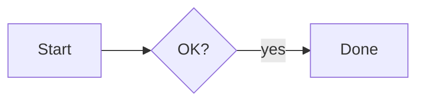

# Markdown Lens

Markdown Lens is a Chromium extension (Brave, Chrome, Chromium, Edge) that
renders Markdown files as HTML when you open them in the browser, for example
`file:///home/you/Desktop/self-hosted-home-alarm-with-home-assistant.md`.
Everything runs locally: the Markdown parser, the HTML sanitizer, the syntax
highlighter, KaTeX and the diagram libraries ship inside the extension, so it
needs no network access and works offline.

### Features

- GitHub Flavored Markdown: tables, task lists, strikethrough, autolinks, fenced code,
  footnotes and alerts (`> [!NOTE]`, `[!TIP]`, `[!IMPORTANT]`, `[!WARNING]`, `[!CAUTION]`).
- Math with [KaTeX](https://katex.org/): `$inline$`, `` $`inline`$ ``, `$$display$$` and ` ```math ` blocks.
- Syntax highlighting for code blocks, with a **Copy** button on each block.
- Diagrams from fenced code blocks: ` ```mermaid `, ` ```flow ` (flowchart.js) and
  ` ```sequence ` (js-sequence-diagrams). Mermaid follows the light/dark theme.
- ` ```plantuml ` blocks are shown as labelled source. PlantUML needs Java or a
  server, and Markdown Lens never sends your files anywhere.
- Light and dark theme: follows your system setting by default, or pick one with the theme button (`d`).
- Table of contents sidebar built from the headings (`t` toggles it).
- Raw Markdown view (`r` toggles between rendered and raw).
- Heading anchors, so `file.md#some-heading` links work.
- YAML/TOML front matter (Hugo, Jekyll) is hidden in a collapsible block, and its `title` becomes the tab title.
- Relative links and images work, because the page keeps the file's own URL.
- Raw HTML inside the Markdown is sanitized with [DOMPurify](https://github.com/cure53/DOMPurify) before display.

## Installation

### Requirements

- A Chromium-based browser with Manifest V3 support (Brave, Chrome, Chromium, Edge).

### Load the unpacked extension

1. Open `brave://extensions` (or `chrome://extensions`).
2. Turn on **Developer mode** (top right).
3. Click **Load unpacked** and select this directory (the one with `manifest.json`).
4. Click **Details** on the *Markdown Lens* card and turn on
   **Allow access to file URLs**. Without this, the extension cannot run on `file://` pages.

Chromium may list `browser_specific_settings` as an unrecognized manifest key.
That key is for Firefox and the warning is harmless.

### Firefox (experimental)

1. Open `about:debugging#/runtime/this-firefox`.
2. Click **Load Temporary Add-on** and select `manifest.json`.
3. Firefox removes temporary add-ons on restart. To keep it installed, sign it
   on [addons.mozilla.org](https://addons.mozilla.org/developers/) (choose
   *unlisted* for personal use).

> **Note:** In LibreWolf 160 the extension renders Markdown served over
> `http(s)`, but content scripts did not run on `file://` pages during testing.
> Local files may not render in Firefox yet.

## Usage

Open any Markdown file in the browser:

```text
file:///home/you/Desktop/self-hosted-home-alarm-with-home-assistant.md
```

Instead of plain text you get a rendered page. Use the buttons in the top right
corner, or the keyboard:

| Key | Action |
| --- | --- |
| `t` | Show or hide the table of contents |
| `r` | Switch between rendered HTML and raw Markdown |
| `d` | Cycle the theme: Auto (system) → Light → Dark |

The theme you pick is remembered for all Markdown files you open.

The extension handles these extensions: `.md`, `.MD`, `.markdown`, `.mdown`,
`.mkd`, `.mkdn` on `file://`, and `.md` / `.markdown` on `http(s)://` when the
server sends them as plain text (for example raw files from a Git host). Pages
that are already HTML are left alone.

To see a file change, reload the tab (`F5`).

### Math and diagrams

````markdown
Euler: $e^{i\pi} + 1 = 0$

$$
\int_0^\infty e^{-x^2}\,dx = \frac{\sqrt{\pi}}{2}
$$



```flow
st=>start: Start
op=>operation: Work
e=>end: End
st->op->e
```

```sequence
Alice->Bob: Hello Bob
Bob-->Alice: Fine
```
````

A `$` followed by a space or a closing `$` followed by a digit is left as text,
so prices such as `$5 and $10` are not treated as math. Write `\$` for a literal
dollar sign.

Mermaid is about 5 MB, so it is loaded only on pages that contain a mermaid
block. If a diagram has a syntax error, the error and the source are shown
instead.

## Project layout

```text
manifest.json        extension manifest (the version lives here)
content.js           detects plain-text Markdown and renders it
content.css          page styling, light and dark
vendor/              bundled third-party libraries (offline)
vendor/katex/        KaTeX script, stylesheet and fonts
vendor/mermaid/      mermaid ES module and its chunks, loaded on demand
icons/               extension icons (icon.svg is the source)
```

### Bundled libraries

| Library | Version | License |
| --- | --- | --- |
| [marked](https://github.com/markedjs/marked) | 15.0.12 | MIT |
| [DOMPurify](https://github.com/cure53/DOMPurify) | 3.2.6 | Apache-2.0 / MPL-2.0 |
| [highlight.js](https://github.com/highlightjs/highlight.js) | 11.11.1 | BSD-3-Clause |
| [marked-footnote](https://github.com/bent10/marked-extensions) | 1.4.0 | MIT |
| [KaTeX](https://github.com/KaTeX/KaTeX) | 0.19.1 | MIT |
| [mermaid](https://github.com/mermaid-js/mermaid) | 12.3.0 | MIT |
| [flowchart.js](https://github.com/adrai/flowchart.js) | 1.17.1 | MIT |
| [js-sequence-diagrams](https://github.com/bramp/js-sequence-diagrams) | 2.0.1 | BSD-2-Clause |
| [Raphaël](https://github.com/DmitryBaranovskiy/raphael) | 2.3.0 | MIT |
| [Underscore.js](https://github.com/jashkenas/underscore) | 1.13.8 | MIT |

To update a library, replace the file in `vendor/` and reload the extension on
the extensions page. For mermaid, replace `vendor/mermaid/` with
`dist/mermaid.esm.min.mjs` and `dist/chunks/mermaid.esm.min/` from the npm
package. flowchart.js 1.18 ships no prebuilt bundle on npm, so 1.17.1 is used.

The KaTeX stylesheet and fonts and the mermaid modules are listed as web
accessible resources, because the page loads them from the extension.

## Contributing

Pull requests are welcome. After you change a file, click the reload icon on the
extension card in `brave://extensions`, then reload the Markdown tab.

## License

[MIT](https://choosealicense.com/licenses/mit/)
