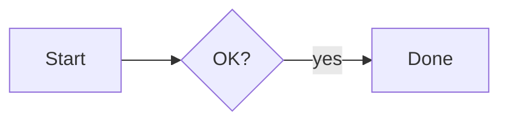

# Markdown Lens

Markdown Lens is a browser extension for Chromium browsers (Brave, Chrome,
Chromium, Edge) and, experimentally, Firefox and LibreWolf. It renders Markdown
files as HTML when you open them in the browser, for example this repository's
[`tests/manual-test.md`](tests/manual-test.md). Everything runs locally: the
Markdown parser, the HTML sanitizer, the syntax highlighter, KaTeX and the
diagram libraries ship inside the extension, so it needs no network access and
works offline.

Watch Markdown Lens in action, 37s video.

https://github.com/user-attachments/assets/96f5944e-14f9-463b-9d3e-32877c473feb

### Features

- GitHub Flavored Markdown: tables, task lists, strikethrough, autolinks, fenced code,
  footnotes and alerts (`> [!NOTE]`, `[!TIP]`, `[!IMPORTANT]`, `[!WARNING]`, `[!CAUTION]`).
- Math with [KaTeX](https://katex.org/): `$inline$`, `` $`inline`$ ``, `$$display$$` and ` ```math ` blocks.
- Syntax highlighting for code blocks, with a **Copy** button on each block.
- Diagrams from fenced code blocks: ` ```mermaid `, ` ```flow ` (flowchart.js) and
  ` ```sequence ` (js-sequence-diagrams). Mermaid follows the light/dark theme.
- ` ```plantuml ` blocks are shown as labelled source. PlantUML needs Java or a
  server, and Markdown Lens never sends your files anywhere.
- Light and dark theme: follows your system setting by default, or pick one with the theme button (`d`).
- Table of contents sidebar built from the headings (`t` toggles it).
- Raw Markdown view (`r` toggles between rendered and raw).
- Heading anchors, so `file.md#some-heading` links work.
- YAML/TOML front matter (Hugo, Jekyll) is hidden in a collapsible block, and its `title` becomes the tab title.
- Relative links and images work, because the page keeps the file's own URL.
- Raw HTML inside the Markdown is sanitized with [DOMPurify](https://github.com/cure53/DOMPurify) before display,
  and so is every rendered diagram. Form controls are removed, so a document cannot show a fake login form.

## Installation

### Requirements

- A Chromium-based browser with Manifest V3 support (Brave, Chrome, Chromium, Edge),
  or Firefox / LibreWolf 140 or newer.

### Download

Each [release](https://github.com/ebal/MarkdownLens/releases) has two files:

- `markdown-lens-X.Y.Z.zip` for Chromium browsers: unzip it into a folder and
  load that folder as described below.
- `markdown-lens-X.Y.Z.xpi` for Firefox and LibreWolf (not signed by Mozilla;
  see below). Firefox users can install the signed add-on from
  addons.mozilla.org instead.

You can also clone the repository and load it directly:

```bash
git clone https://github.com/ebal/MarkdownLens.git
```

### Chromium browsers (Brave, Chrome, Chromium, Edge)

1. Open `brave://extensions` (or `chrome://extensions`).
2. Turn on **Developer mode** (top right).
3. Click **Load unpacked** and select the folder that contains `manifest.json`.
4. Click **Details** on the *Markdown Lens* card and turn on
   **Allow access to file URLs**. Without this, the extension cannot run on `file://` pages.

Chromium may list `browser_specific_settings` as an unrecognized manifest key.
That key is for Firefox and the warning is harmless.

### Firefox and LibreWolf

**From addons.mozilla.org (recommended):** every release is submitted to
[addons.mozilla.org](https://addons.mozilla.org/firefox/search/?q=Markdown%20Lens),
where Mozilla reviews and signs it. Install Markdown Lens from there, and
Firefox keeps it up to date. A new version shows up there only after Mozilla's
review, which can take from minutes to a few days.

**From the release `.xpi`:** the `.xpi` attached to each Gitea and GitHub
release is not signed by Mozilla, so how you install it depends on the browser.

**LibreWolf** (and Firefox Developer Edition, Nightly or ESR):

1. Open `about:config` and set `xpinstall.signatures.required` to `false`.
2. Open `about:addons`, click the gear icon, choose **Install Add-on From File…**
   and select the `.xpi`.

**Firefox** (release): load it as a temporary add-on, which Firefox removes on
restart, or install it from addons.mozilla.org instead.

1. Open `about:debugging#/runtime/this-firefox`.
2. Click **Load Temporary Add-on** and select the `.xpi` or `manifest.json`.

Then, in both browsers, open `about:addons` → **Markdown Lens** →
**Permissions** and turn on access to websites. Firefox asks for this
separately for Manifest V3 add-ons; without it, Markdown files stay plain text.

#### Local files (`file://`)

With the add-on installed and its site access turned on, LibreWolf 160 renders
local Markdown files, for example:

```text
file:///path/to/MarkdownLens/tests/manual-test.md
```

Firefox has no separate switch for file URLs like Chromium's **Allow access to
file URLs**; the site access permission is enough.

If a local file still shows as plain text:

1. Check **Permissions** again, then reload the tab with `Ctrl+Shift+R`. Tabs
   that were open before you changed the permission keep showing plain text
   until they are reloaded.
2. Check that the file name ends in `.md`, `.MD`, `.markdown`, `.mdown`, `.mkd`
   or `.mkdn`; other names are not handled.
3. Open the Browser Console (`Ctrl+Shift+J`) and look for errors that mention
   Markdown Lens or `content.js`.

If Firefox offers to download the file instead of showing it, the extension
never gets a page to render. Open the file from an `http(s)://` server that
sends it as `text/plain` instead.


## Usage

Open any Markdown file in the browser, for example the test page in this
repository:

```text
file:///path/to/MarkdownLens/tests/manual-test.md
```

Instead of plain text you get a rendered page. Use the buttons in the top right
corner, or the keyboard:

| Key | Action |
| --- | --- |
| `t` | Show or hide the table of contents |
| `r` | Switch between rendered HTML and raw Markdown |
| `d` | Cycle the theme: Auto (system) → Light → Dark |

The theme you pick and whether the table of contents is open are remembered
for all Markdown files you open, on every site and on local files.

The extension handles these extensions: `.md`, `.MD`, `.markdown`, `.mdown`,
`.mkd`, `.mkdn` on `file://`, and `.md` / `.markdown` on `http(s)://` when the
server sends them as plain text (for example raw files from a Git host). Pages
that are already HTML are left alone. The URL must end in the extension: a
query string such as `file.md?raw=1` is not matched.

To see a file change, reload the tab (`F5`).

### Math and diagrams

````markdown
Euler: $e^{i\pi} + 1 = 0$

$$
\int_0^\infty e^{-x^2}\,dx = \frac{\sqrt{\pi}}{2}
$$



```flow
st=>start: Start
op=>operation: Work
e=>end: End
st->op->e
```

```sequence
Alice->Bob: Hello Bob
Bob-->Alice: Fine
```
````

A `$` followed by a space or a closing `$` followed by a digit is left as text,
so prices such as `$5 and $10` are not treated as math. Write `\$` for a literal
dollar sign.

Mermaid is about 5 MB, so it is loaded only on pages that contain a mermaid
block. It runs in a hidden extension page (`mermaid.html`) inside the Markdown
page, because Firefox's content-script sandbox breaks it. If a diagram has a
syntax error, the error and the source are shown instead.

## Privacy

Markdown Lens itself sends nothing over the network: no analytics and no
requests. The Markdown parser, KaTeX and the diagram libraries run inside the
extension.

**What it can access.** The extension runs on URLs that end in `.md` or
`.markdown` on any website, and on local Markdown files. Browsers treat that as
access to every site, because site access is granted per host, not per path.
On a matching page it only does something when the browser shows the file as
plain text; other pages are left alone. It asks for one browser permission,
`storage`, to keep two settings: the theme and whether the table of contents is
open. Nothing else is stored. Versions up to 0.2.3 kept these settings in each
website's own storage; newer versions move them into the extension and remove
them from the site.

**What documents can load.** A rendered document is a web page, and like any
web page it can load remote content when it opens:

- Remote images (`` or ``), and the
  sources of `<video>` and `<audio>`.
- `url(…)` inside `style` attributes of raw HTML.

The server that hosts that content sees when, and from which IP address, the
document was opened. This works even for a local file, so a Markdown file can
contain a tracking pixel. Links are only followed when you click them.

To read an untrusted file without loading anything, open it with a text editor,
or turn the extension off before opening it.

Raw HTML, links and diagrams are sanitized with DOMPurify, so scripts in
documents do not run, and form controls are removed.

## Project layout

```text
manifest.json        extension manifest (the version lives here)
content.js           detects plain-text Markdown and renders it
content.css          page styling, light and dark
mermaid.html         hidden page that renders mermaid diagrams for content.js
mermaid-frame.js     its script: receives diagram source, returns the SVG
vendor/              bundled third-party libraries (offline)
vendor/katex/        KaTeX script, stylesheet and fonts
vendor/mermaid/      mermaid ES module and its chunks, loaded by mermaid.html
icons/               extension icons (icon.svg is the source)
tools/               release scripts used by the CI workflows
tests/manual-test.md manual test page covering every feature
.gitea/, .github/    release workflows for Gitea and GitHub
amo-metadata.json    addons.mozilla.org listing details and reviewer notes
LICENSE              MIT license
```

### Bundled libraries

| Library | Version | License |
| --- | --- | --- |
| [marked](https://github.com/markedjs/marked) | 15.0.12 | MIT |
| [DOMPurify](https://github.com/cure53/DOMPurify) | 3.5.0 | Apache-2.0 / MPL-2.0 |
| [highlight.js](https://github.com/highlightjs/highlight.js) | 11.11.1 | BSD-3-Clause |
| [marked-footnote](https://github.com/bent10/marked-extensions) | 1.4.0 | MIT |
| [KaTeX](https://github.com/KaTeX/KaTeX) | 0.19.1 | MIT |
| [mermaid](https://github.com/mermaid-js/mermaid) | 12.3.0 | MIT |
| [flowchart.js](https://github.com/adrai/flowchart.js) | 1.17.1 | MIT |
| [js-sequence-diagrams](https://github.com/bramp/js-sequence-diagrams) | 2.0.1 | BSD-2-Clause |
| [Raphaël](https://github.com/DmitryBaranovskiy/raphael) | 2.3.0 | MIT |
| [Underscore.js](https://github.com/jashkenas/underscore) | 1.13.8 | MIT |

To update a library, replace the file in `vendor/` and reload the extension on
the extensions page. For mermaid, replace `vendor/mermaid/` with
`dist/mermaid.esm.min.mjs` and `dist/chunks/mermaid.esm.min/` from the npm
package. flowchart.js 1.18 ships no prebuilt bundle on npm, so 1.17.1 is used.

The KaTeX stylesheet and fonts and `mermaid.html` are listed as web accessible
resources, because the Markdown page loads them from the extension.

## Contributing

Pull requests are welcome. After you change a file, click the reload icon on the
extension card in `brave://extensions`, then reload the Markdown tab.

Open [`tests/manual-test.md`](tests/manual-test.md) in each browser to check
every feature by hand; each section says what you should see.

### Releases

Every release has a `.zip` (Chromium) and an `.xpi` (Firefox) attached on its
Gitea and GitHub release page. To make one:

1. Set the new version in `manifest.json` and move the `[Unreleased]` entries in
   `CHANGELOG.md` into a section for that version.
2. Commit as `chore(release): X.Y.Z` and tag it:

   ```bash
   git tag -a vX.Y.Z -m "Markdown Lens X.Y.Z"
   git push origin main vX.Y.Z
   git push github main vX.Y.Z
   ```

The release workflow checks that the tag matches the manifest version, builds
the packages with `tools/build.sh`, and uses the version's `CHANGELOG.md`
section as the release notes. To build the packages locally (needs `node` and
`zip`), run:

```bash
./tools/build.sh
```

If a tag did not get a GitHub release (for example because the workflow did
not run), open **Actions → Release → Run workflow** on GitHub and enter the
tag, such as `v0.2.2`. Running it again for a tag that already has a release
replaces the attached files.

The packages are written to `dist/`, which git ignores. If the Gitea job fails with
HTTP 403, add a personal access token with the `write:repository` scope as the
repository secret `RELEASE_TOKEN`.

On GitHub, a second job (`amo`) lints the extension with Mozilla's `web-ext`
and submits the version to addons.mozilla.org on the listed channel, using the
listing details in `amo-metadata.json`. It needs the repository secrets
`AMO_JWT_ISSUER` and `AMO_JWT_SECRET` (API keys from
<https://addons.mozilla.org/developers/addon/api/key/>) and is skipped without
them. It does not wait for Mozilla's review. AMO accepts each version only
once, so only GitHub submits; Gitea never does.

## License

[MIT](LICENSE)
