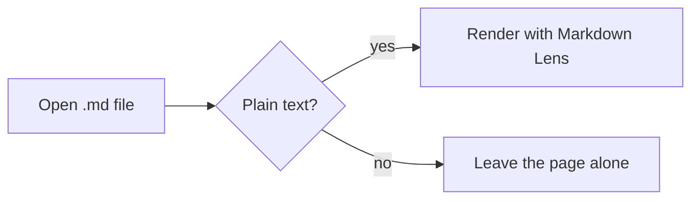
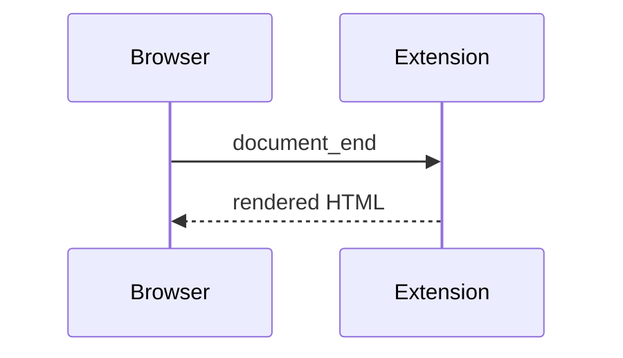
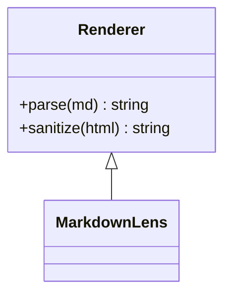
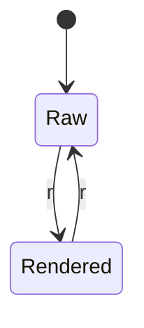
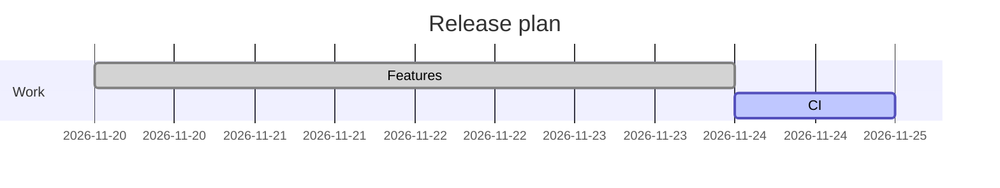
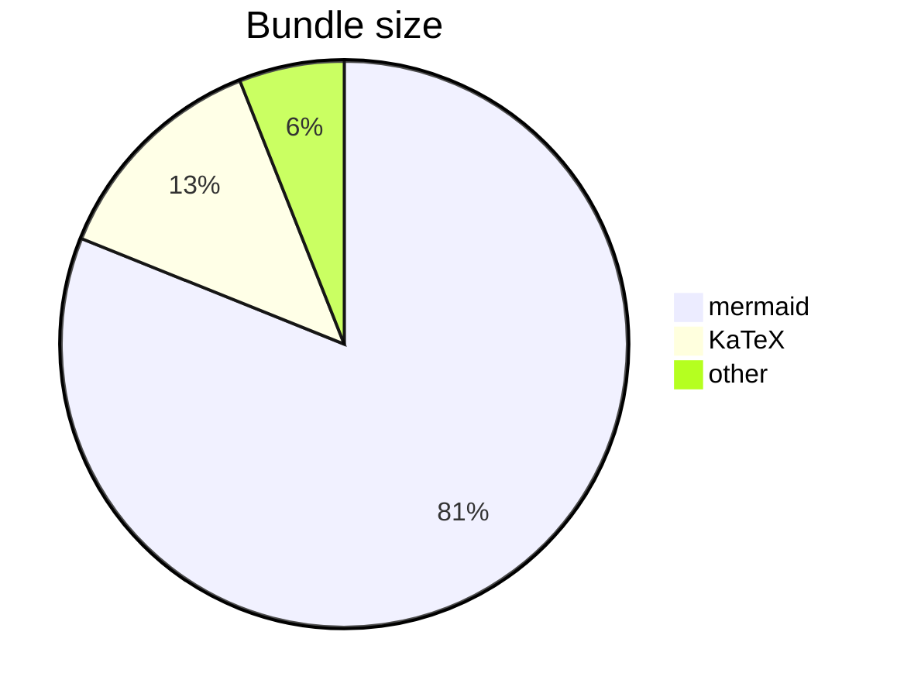
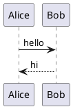

# Markdown Lens manual test

Open this file in the browser (`file:///…/tests/manual-test.md`) with the
extension loaded. Each section says what you should see. Anything that looks
different is a bug.

**Page checks**

- [ ] The tab title is **Markdown Lens manual test** (from the front matter, not the file name).
- [ ] A collapsed **Front matter** block is at the top; it opens to show the YAML.
- [ ] Top right: **Contents**, **Raw** and the theme button.
- [ ] `t` toggles the table of contents, `r` toggles raw Markdown, `d` cycles Auto → Light → Dark.
- [ ] Reload the tab: the theme and the TOC state are remembered.
- [ ] Hovering a heading shows a `#` link to its left.

## 1. Text formatting

Plain paragraph with **bold**, *italic*, ***bold italic***, ~~strikethrough~~,
and `inline code`. This line ends with a backslash\
so this one starts on a new line, while this
line joins the previous one into the same paragraph.

Expected: each style renders, and only the backslash forces a line break.

## 2. Links and images

- External link (opens in a **new tab**): [example.com](https://example.com)
- Autolink (GFM): https://example.org
- Email autolink: <user@example.com>
- Same-page anchor (scrolls to section 7): [Jump to code blocks](#7-code-blocks)
- Relative link (opens the README rendered): [README](../README.md)
- Relative image (the extension icon, 64 px wide):


## 3. Headings for the table of contents

### Level three heading

#### Level four heading

##### Level five heading (not in the TOC)

###### Level six heading (muted, not in the TOC)

### Duplicate heading

### Duplicate heading

Expected: the TOC shows levels 1–4 only. The two "Duplicate heading" anchors
are `#duplicate-heading` and `#duplicate-heading-1`:
[first](#duplicate-heading), [second](#duplicate-heading-1).

## 4. Lists

1. Ordered item one
2. Ordered item two
   - Nested bullet
     - Deeper bullet
3. Ordered item three

- Bullet with a paragraph

  Second paragraph inside the same item.

GFM task list:

- [x] Done task (checked, disabled)
- [ ] Open task
  - [x] Nested done task

## 5. Tables

| Left aligned | Centered | Right aligned |
| :----------- | :------: | ------------: |
| apples       |    3     |         $1.20 |
| `code`       | **bold** |     ~~0.00~~  |
| a very long cell that wraps onto several lines, so the table never gets wider than the page | x | y |

Expected: alternating row shading, column alignment as in the header, and
the long cell wraps.

## 6. Quotes and GitHub alerts

> A plain blockquote, muted, with a grey bar.
>
> > Nested quote.

> [!NOTE]
> Blue **Note** alert.

> [!TIP]
> Green **Tip** alert.

> [!IMPORTANT]
> Purple **Important** alert.

> [!WARNING]
> Amber **Warning** alert.

> [!CAUTION]
> Red **Caution** alert.

> [!UNKNOWN]
> Not a known alert type: stays a plain blockquote showing `[!UNKNOWN]`.

## 7. Code blocks

Each block below is highlighted and shows a **Copy** button on hover.

```python
from dataclasses import dataclass

@dataclass
class Point:
    x: float
    y: float

    def norm(self) -> float:
        return (self.x ** 2 + self.y ** 2) ** 0.5
```

```javascript
const greet = (name = "world") => `Hello, ${name}!`;
console.log(greet());
```

```bash
#!/bin/bash
set -euo pipefail
for f in *.md; do echo "rendering $f"; done
```

```yaml
services:
  web:
    image: nginx:1.27
    ports: ["8080:80"]
```

```json
{ "name": "markdown-lens", "version": "0.2.1", "offline": true }
```

```diff
- old line
+ new line
```

No language given (highlight.js guesses):

```
SELECT id, name FROM users WHERE active = 1 ORDER BY name;
```

Unknown language (still shown, auto-highlighted):

```notalanguage
just some text
```

## 8. Math (KaTeX)

Inline: the mass–energy relation $E = mc^2$, a fraction $\frac{a}{b}$, and Greek
$\alpha + \beta = \gamma$.

GitHub-style inline: $`\sqrt{x^2 + y^2}`$.

Display math inside a sentence: $$\sum_{k=1}^{n} k = \frac{n(n+1)}{2}$$ moves to its own centered line.

Display block:

$$
\int_0^\infty e^{-x^2}\,dx = \frac{\sqrt{\pi}}{2}
$$

Fenced `math` block:

```math
\begin{aligned}
  \nabla \cdot \mathbf{E} &= \frac{\rho}{\varepsilon_0} \\
  \nabla \times \mathbf{B} &= \mu_0 \mathbf{J} + \mu_0 \varepsilon_0 \frac{\partial \mathbf{E}}{\partial t}
\end{aligned}
```

Matrix:

$$
A = \begin{pmatrix} 1 & 2 \\ 3 & 4 \end{pmatrix}
$$

Must stay **plain text** (not math):

- Prices: it costs $5 and $10 in total.
- Escaped dollar: \$HOME is a variable.
- Inside code: `$not math$`

Broken TeX (should show in red, page keeps working): $\frac{1}{$

## 9. Diagrams

### Mermaid flowchart



### Mermaid sequence diagram



### Mermaid class, state, gantt and pie









Expected: mermaid diagrams change colours when you switch the theme with `d`.

### Mermaid with an error

```mermaid
graph LR
  A --> 
```

Expected: a red "mermaid diagram error" message with the source below it.

### flowchart.js

```flow
st=>start: Start
in=>inputoutput: Read file
cond=>condition: Is Markdown?
op=>operation: Render
e=>end: End
st->in->cond
cond(yes)->op->e
cond(no)->e
```

### Sequence diagram (js-sequence-diagrams)

```sequence
Title: Opening a file
Browser->Extension: page loaded
Note right of Extension: parse + sanitize
Extension-->Browser: rendered page
Browser->Browser: user presses d
```

Expected: flowchart.js and sequence diagrams sit on a white card, also in dark
mode.

### PlantUML



Expected: shown as source with a small **PlantUML** label, not rendered.

## 10. Footnotes

Markdown Lens supports footnotes.[^note] They can have names too.[^named]
Using the same footnote twice is fine.[^note]

[^note]: A footnote. The ↩ link jumps back to where it was used.
[^named]: A named footnote, numbered automatically.

Expected: superscript numbers; a **Footnotes** list at the bottom of the page,
not in the TOC.

## 11. Raw HTML and sanitizing

<details>
<summary>Click to expand (HTML details)</summary>

Hidden content inside `<details>`.

</details>

Press <kbd>Ctrl</kbd> + <kbd>C</kbd>. H<sub>2</sub>O, x<sup>2</sup>,
<mark>highlighted text</mark>.

The next lines try to run JavaScript. **No alert box may appear**, and the
broken image must not run its `onerror` handler:

<script>alert("script tag ran: sanitizing is broken")</script>

<a href="javascript:alert('javascript link ran')">javascript: link (should do nothing)</a>

## 12. Miscellaneous

Horizontal rule below:

---

Unicode and emoji: café, naïve, Ελληνικά, 日本語, 🚀 ✅.

A very long word that must wrap instead of widening the page:
Supercalifragilisticexpialidocious-Supercalifragilisticexpialidocious-Supercalifragilisticexpialidocious.

End of the test page. Press `r` now: you should see this file's raw Markdown,
and `r` again returns here.
